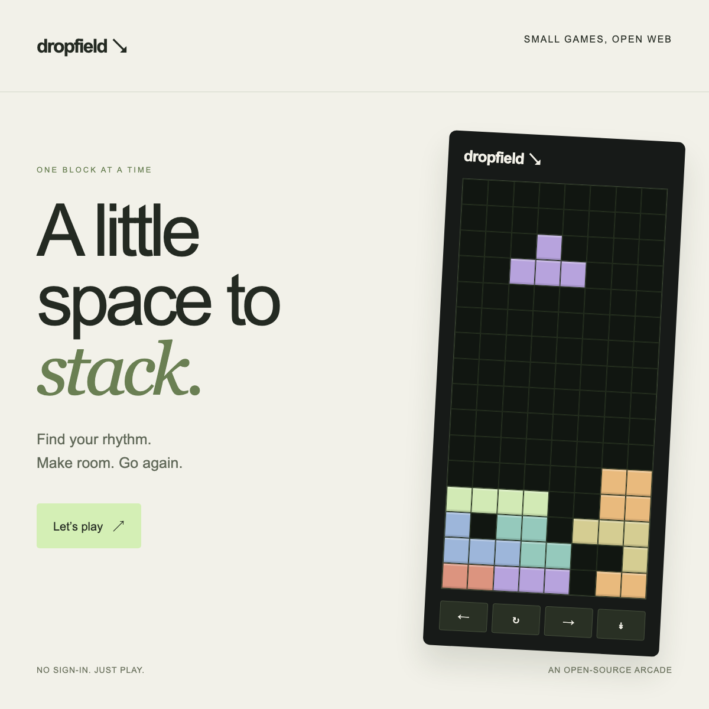

# X Player Cards

**Make a small web app that can open inside an X post.** A reusable agent skill, a playable example, and a Vercel deployment recipe—adapted from [The House's implementation notes](https://thehouse.game/updates/2026-10-22-interactive-x-embeds).

The example is **Dropfield**, an original falling-block arcade: seven shapes, row clearing, a ghost landing guide, increasing speed, keyboard and touch controls, and optional synthesized sound. No accounts, cookies, storage, runtime dependencies, or backend.



## Use the skill

Clone this repository into your agent's skills directory. The root is a self-contained skill: `SKILL.md`, supporting references, scripts, and the example travel together.

For Codex:

```sh
git clone https://github.com/0xFlicker/x-player-cards.git ~/.agents/skills/x-player-cards
```

Then ask:

> Use $x-player-cards to make an interactive music visualizer that can open inside an X post. Use the included example as the starting point and deploy it to Vercel.

For other agents, place the folder in their supported skill location, or ask the agent to read [`SKILL.md`](SKILL.md) directly. The guidance is framework-independent; Bun is only needed for the included starter's tools.

## Run or remix Dropfield

```sh
git clone https://github.com/0xFlicker/x-player-cards.git
cd x-player-cards
bun install --frozen-lockfile
bun run dev
```

Open `http://localhost:4173/`. Use ←/→ to move, ↑ to rotate, ↓ to descend, Space to drop, and P to pause. The onscreen buttons work on touchscreens. Sessions are in memory; reloading starts fresh.

Edit `site.config.json`, customize `examples/dropfield/`, and follow [the deployment guide](references/deployment.md). Import your fork into Vercel as an **Other** project; the included configuration builds the site and applies the response headers. No environment variables are needed on a standard Vercel hostname; set `SITE_URL` for a custom domain. Replace account attribution and repository links when forking.

## How it works

```text
Post the share page URL
  → X reads its initial HTML metadata and poster
  → A reader activates the card
  → X may load the separate HTML player in its sandbox
```

| Resource | Starter path | Purpose |
| --- | --- | --- |
| Share page | `/` | Full page + X/Open Graph metadata |
| Player | `/embed/` | Compact, anonymous HTML game |
| Poster | `/poster.png` | Public raster preview |

`twitter:player` points to HTML. There is no X SDK, OAuth flow, or posting API in this app. The player response allows X frame ancestors; the ordinary page denies framing. A new-tab link opens the full page. GitHub Pages cannot configure the required custom header policy, so this starter deploys to Vercel.

**Platform caveat:** valid metadata and a working iframe do not guarantee X will display an interactive card for every domain or client. The original research observed desktop behavior. Test an actual authorized X post and relevant mobile clients before claiming support. This repository does not post anything for you.

## Verify

```sh
bun test tests
bunx playwright install chromium
bun run test:browser
bun run verify:live https://YOUR-DEPLOYMENT/
```

Read [verification](references/verification.md) for what these checks establish. The browser suite uses nested cross-origin sandbox frames, denies storage, and exercises real controls at small and large sizes.

## What's inside

- [`SKILL.md`](SKILL.md): agent workflow and essential constraints.
- [`references/integration.md`](references/integration.md): metadata, framing, sandbox permissions, anonymous reads, shared state, Next.js, and sources.
- [`references/deployment.md`](references/deployment.md): customization, Vercel, and portable hosting.
- [`examples/dropfield/`](examples/dropfield/): original game and artwork; pure engine separated from the DOM.
- [`scripts/`](scripts/): build, local server, test harness, poster generation, and public verification.
- [`vercel.json`](vercel.json): static build and route-specific HTTP headers.

MIT licensed. The skill and example are independent of X and Vercel. No third-party game name, artwork, music, or proprietary code is included.
